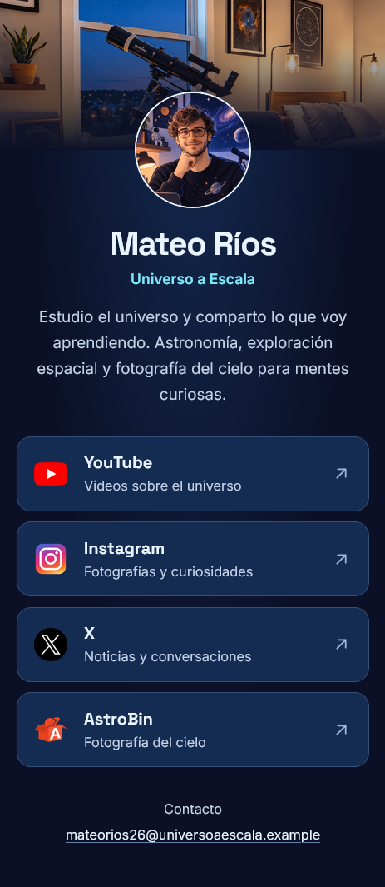

# Universo a Escala

Una página **link in bio** para Mateo Ríos, divulgador de astronomía. Reúne
sus redes sociales y recursos en un solo lugar, con un diseño inspirado en
el cielo nocturno.



## Versiones

El proyecto explora tres versiones de la página, cada una en su propia rama:

| Versión | Rama | Contenido |
| --- | --- | --- |
| Esencial | `main` | Perfil, redes sociales y contacto. |
| Personalizado | `feat/plan-personalizado` | Añade un video destacado y una galería de astrofotografía. |
| A Medida | `feat/plan-a-medida` | Incluye un carrusel interactivo, portadas de guías y un fondo estrellado animado. |

## Ejecutar localmente

Es un sitio estático: no necesita instalar dependencias ni ejecutar una
compilación. Puedes abrir `index.html` directamente en el navegador o,
si tienes Python instalado, iniciar un servidor local:

```powershell
python -m http.server 8000
```

Ejecuta el comando desde la raíz del proyecto y visita
<http://localhost:8000>. Para detener el servidor, presiona `Ctrl+C`.

## Tecnologías y estructura

El sitio utiliza HTML, CSS y JavaScript sin frameworks. El contenido y los
estilos se adaptan a distintos tamaños de pantalla; las versiones con
animación contemplan la preferencia de movimiento reducido.

```text
index.html       Página principal
assets/
  fonts/         Fuentes
  icons/         Iconos de redes sociales
  images/        Imágenes de perfil, fondos, fotografías y portadas
  scripts/       Lógica JavaScript
  styles/        Estilos y accesibilidad
  text/          Textos de referencia
  video/         Video destacado y su portada
miro/journal.md  Bitácora de desarrollo
```
