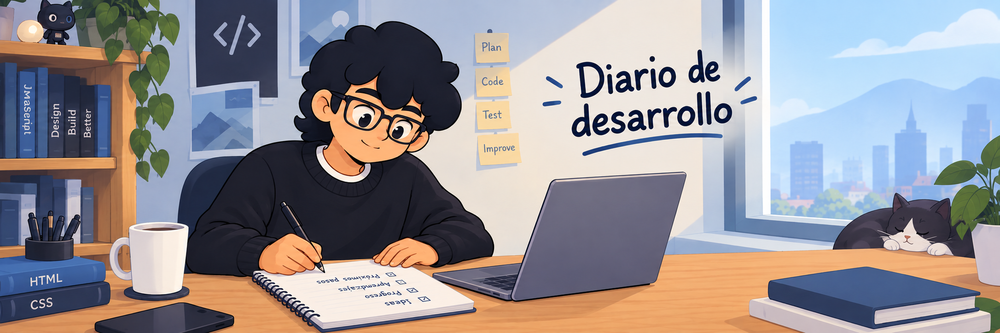
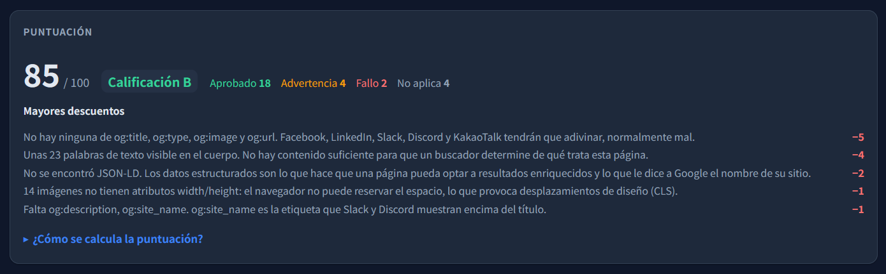
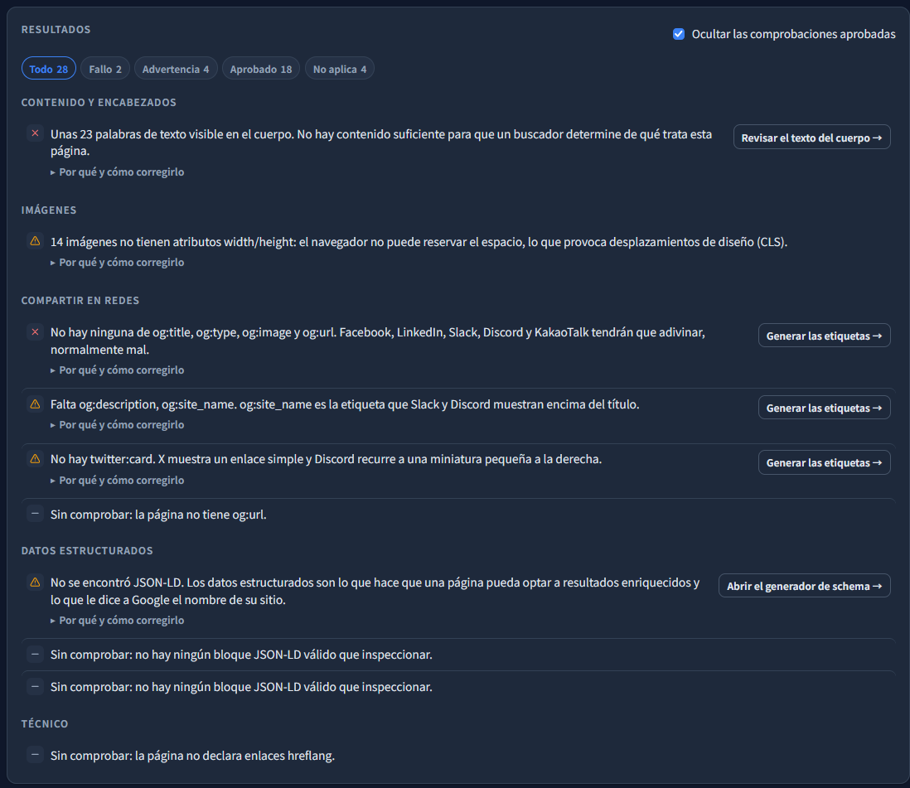
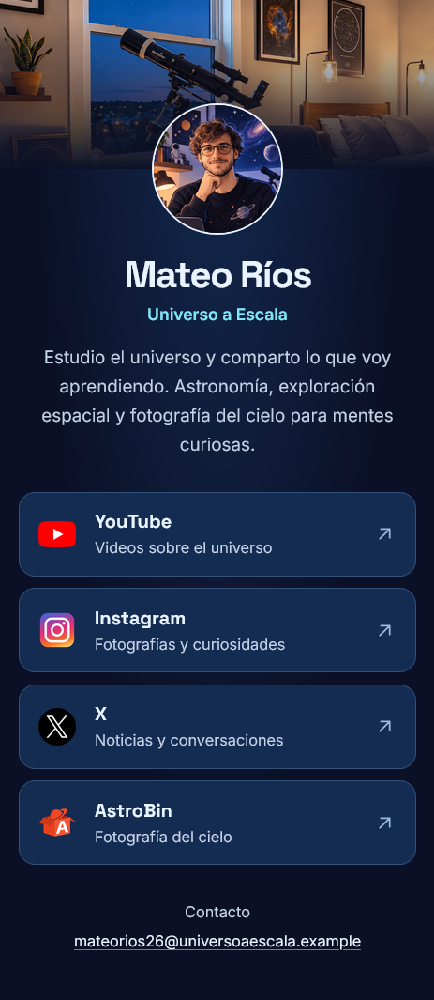

# 🌌 Journal

La idea es crear una página Link in Bio para un divulgador que estudia
astronomía por cuenta propia, comparte contenido educativo en redes sociales
y quiere centralizar su actividad en un único espacio digital.

El reto no será simplemente reunir enlaces: la página debe transmitir
curiosidad científica, facilitar el acceso a sus publicaciones y permitir
que otros aficionados a la astronomía encuentren sus recursos y se conecten
con él.

## 📅 15-11-26 — Inicia el proyecto

### 🎯 Preparar Contenido

**Reuniré y organizaré todos los recursos multimedia antes de empezar el
desarrollo para agilizar la implementación**

- Confirmar destinos de redes, recursos y correo.
- Seleccionar y optimizar retrato, fotografías, miniatura del video e imagen social.
- Revisar títulos, biografía y textos alternativos.

**Criterio de éxito:** Los recursos multimedia están reunidos, organizados en
`assets/` y registrados en un commit; adjuntaré su hash como evidencia.

### 🧭 Plan de trabajo

- [x] Crear todos los fondos de los contenedores de los enlaces.
- [x] Reemplazar la foto de perfil de Mateo por una hecha con IA.
- [x] Optimizar toda la multimedia haciendo uso de compresores web.
- [x] Organizarlo todo en carpetas semánticas y jerarquicas.
- [x] Verificar esta checklist.
- [x] Adjuntar el hash del commit.

### 🎧 Lo que escuché en la sesión

- **Álbum o canción:** Starbucks bajo la lluvia ☕️ Jazz relajante y sonidos de
    lluvia para estudiar y trabajar [ACNH]
- **Artista:** Chill Mori BGM
- **Escuché en:** YouTube
- **Enlace:** https://www.youtube.com/watch?v=U74Pmp4BJok

### 🛠️ Trabajo realizado

#### Lo que hice

- Creé fondos visuales para los contenedores de enlaces de las plataformas.
- Reemplacé la fotografía de perfil de Mateo por una imagen generada con IA.
- Optimicé los recursos multimedia con compresores web para reducir su peso.
- Organicé imágenes, iconos y video en una estructura semántica dentro de
  `assets/`.

#### Decisiones técnicas

- **Decisión:** [Qué elegí hacer]
- **Motivo:** [Por qué elegí esta opción]
- **Alternativas:** [Qué otra opción consideré, si aplica]

#### Evidencia del progreso

- **Commit:** `db30e0e74eb6ae89c34dbe2f27c901dc20390160`
- **Captura o demo:** 

### ✅ Cierre de la sesión

**Resultado concreto:** Recursos multimedia organizados y optimizados.

**Estado del proyecto tras la sesión:** Fase uno terminada.

**Deuda técnica o mejora futura:** Hay dos recursos que en sus respectivos conjuntos
tienen un tamaño un poco más grande que sus hermanos. Los arreglaré en la siguiente
sesión.

### 👣 Próximos pasos

- [x] Estructurar la página
- [x] Construir HTML semántico.

**Punto de reanudación:** `index.html`

---

## 📅 16-11-26 — Maquetación

### 🎯 Estructurar la página

**Organizar, dar formato semántico y accesible al contenido de la página para
un mejor performance en las tecnologías que lo usarán.**

- Ordenar perfil, enlaces, contenido destacado, galería, recursos, evento y contacto.
- Construir HTML semántico e incorporar metadatos de SEO y compartición.

**Criterio de éxito:** El contenido tiene una jeraquía clara, semántica y
accesible. Adjuntaré el hash del commit y captura de la evaluación hecha en [NumLM Tools](https://tools.numlm.com/seo/seo-analyzer/?utm_source=chatgpt.com).

### 🧭 Plan de trabajo

- [x] Agregar metadatos básicos.
- [x] Seleccionar la multimedia y estructurarlas con las etiquetas más adecuadas.
- [x] Dar clases a las etiquetas con BEM.
- [x] Agregar etiquetas para accesibilidad.
- [x] Añadir atributos data-* para lógica JavaScript.

### 🎧 Lo que escuché en la sesión

- **Álbum o canción:** spring mornings. 🌸 studio ghibli style lofi mix
- **Artista:** The Jazz Hop Café
- **Escuché en:** YouTube
- **Enlace:** https://www.youtube.com/watch?v=wePMdTNW3C4

### 🛠️ Trabajo realizado

#### Lo que hice

- Estructuré la página principal como una link in bio accesible para Mateo
    Ríos, usando etiquetas semánticas, jerarquía de encabezados, navegación por
    secciones y pie de contacto.
- Añadí metadatos básicos de SEO, clases con convención BEM y atributos
    `data-*` para separar los estilos de la lógica del carrusel.
- Mejoré la accesibilidad mediante textos alternativos, enlace para saltar al
    contenido principal, foco visible, controles de carrusel operables con
    teclado y anuncios de cambios para lectores de pantalla.
- Modifiqué `index.html` y añadí `assets/styles/accessibility.css` y `assets/scripts/carousel.js`.
- Utilicé HTML5, CSS y JavaScript vanilla, además de una revisión de
    accesibilidad y validación de sintaxis del script.

#### Decisiones técnicas

- **Decisión:** Separar identificadores para estilos y lógica: clases para estilos y atributos `data-*` para lógica.
- **Motivo:** Mantener de forma idependiente ambos aspectos del proyecto.
- **Alternativas:** Usar clases para ambos objetivos.

#### Evidencia del progreso

- **Commit:** `c133d0ae0f94f921a0f36aeb70431bca2b04d6c2`
- **Captura o demo:**  

#### Recursos consultados

- [NumLM Tools](https://tools.numlm.com/seo/seo-analyzer/?utm_source=chatgpt.com) — Realicé una inspección de mi documento HTML.

### 🧪 Comprobación del resultado

**¿Cómo comprobé que funciona?**

- [x] Comprobé que `index.html` carga los archivos de estilos y JavaScript.
- [x] Realicé una inspección con NumLM Tools.

**Resultado observado:** La estructura y la sintaxis son correctas. Tienen una
puntuación aceptable.

### ✅ Cierre de la sesión

**Resultado concreto:** Estructura HTML organizada y semántica.

**Estado del proyecto tras la sesión:** Listo para realizar el diseño.

**Deuda técnica o mejora futura:** Añadir o corregir las observaciones de NumLM Tools.

En cuanto a los recursos que tienen un tamaño un poco mayor que el de sus
hermanos lo corregiré con CSS.

### 👣 Próximos pasos

- [x] Realizar el diseño de la página.

**Próximo objetivo de aprendizaje:** CSS organizado y modularizado, correcto uso
del nesting y popover.

**Punto de reanudación:** `./assets/styles/main.css`

---

## 📅 17-11-26 — Diseño con AI

### Aplicar estilo a la página

**Realizaré el estilo de la página, pero no a mano, usaré la skill `IMPECCABLE`
ya que cuando atienda varios clientes a la vez necesito ser veloz**

- Aplicar paleta nocturna y jerarquía tipográfica.
- Implementar adaptación para móvil, tableta y escritorio.
- Añadir enlaces, galería y componentes interactivos con JavaScript vanilla.
- Aplicar movimiento solo si respeta `prefers-reduced-motion`.

**Criterio de éxito:** adjuntaré el hash del commit y capturea del resultado.

### 🧭 Plan de trabajo

- [x] Hablaré con GitHub Copilot sobre como realizarlo con Impeccable.
- [x] Le daré algunos detalles que debe tener en cuenta.
- [x] Y por último le diré que ejecute el prompt resultante de la charla.

### 🎧 Lo que escuché en la sesión

- **Álbum o canción:** 【あつ森】Lofi Night｜雨降る夜に部屋でゆっくりと過ごす☔雨音｜作業・勉強【1時間】
- **Artista:** Tsumugi's Cozy Tunes
- **Escuché en:** YouTube
- **Enlace:** https://www.youtube.com/watch?v=2SV-ueN0hxA

### 🛠️ Trabajo realizado

#### Lo que hice

- Hablé con GitHub Copilot durante un buen rato detallando el objetivo.
- Le ordené ejecutar la tarea.
- Relicé un cambio menor en el borde de la foto de perfil.

#### Decisiones técnicas

- **Decisión:** Remover algunos elementos del documento HTML.
- **Motivo:** Su presencia no entraba en el plan Esencial de mi servicio de
    Links In Bios.
- **Alternativas:** Tomé la decisión de realizar después otras dos versiones de
    mis otros dos planes.

#### Evidencia del progreso

- **Commit:** `8ab34aa7f45b18af662561cba1f47d9e38ed47ab`
- **Captura o demo:** 

### 🧪 Comprobación del resultado

**¿Cómo comprobé que funciona?**

- [x] Probé el comportamiento esperado.
- [x] Revisé los casos relevantes para este cambio.
- [x] Comprobé la versión responsive, si corresponde.
- [x] Revisé errores de consola o herramientas de desarrollo, si corresponde.

**Resultado observado:** Junto con Copilot comprobé que se muestran el perfil,
los cuatro enlaces y el contacto, y que ya no aparecen el video, las guías ni
la galería. La página no presentó desbordamiento horizontal en anchos de 320,
390, 768 y 1440 píxeles. También se revisaron el foco con teclado, el contraste
de los enlaces y la preferencia de movimiento reducido. Al recargar la página
no se observaron errores de consola ni recursos fallidos.

### ✅ Cierre de la sesión

**Resultado concreto:** Página Link in Bio del plan Esencial con perfil,
cuatro enlaces sociales, contacto y diseño responsive.

**Estado del proyecto tras la sesión:** La demostración está implementada y
comprobada. Los destinos y el correo son datos de ejemplo que deben confirmarse
antes de publicar una versión con datos reales.

**Deuda técnica o mejora futura:** Debo realizar las versiones de mis otros planes.

### 👣 Próximos pasos

- [x] Crear ramas para las versiones de los planes Personalizado y A medida.
- [x] Definir el alcance de cada versión antes de implementarla.

**Próximo objetivo de aprendizaje:** Trabajar con ramas en Git.

**Punto de reanudación:** `index.html` y `assets/styles/main.css`, como base
para las versiones de los otros planes.

---
